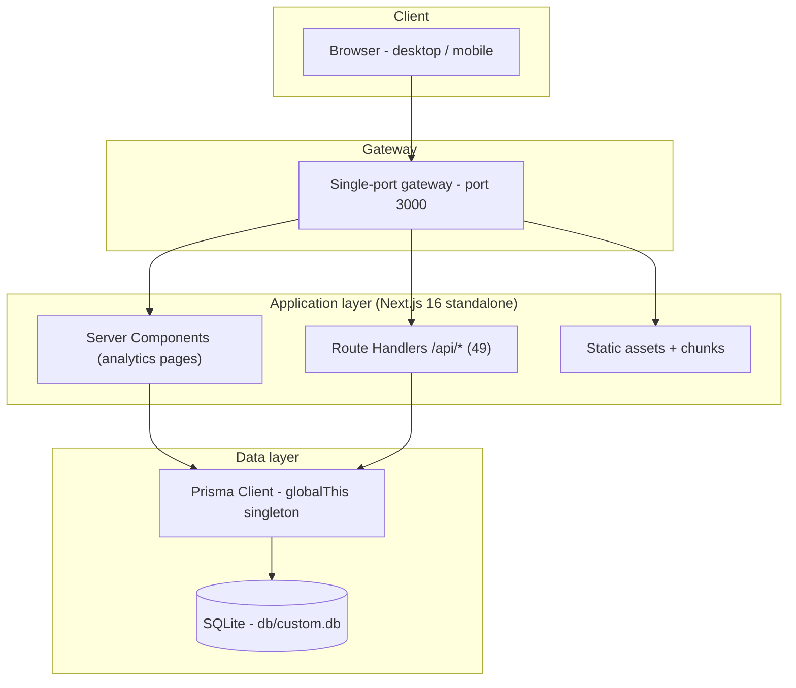
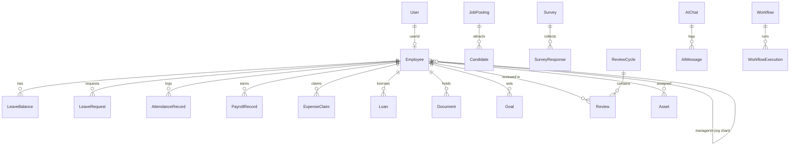

# Eon HR — Master Project Architecture Document (PAD) v1.0.0

**Classification:** Internal Engineering Reference
**Status:** DEFINITIVE, PRODUCTION-LOCKED BLUEPRINT
**Companion Document:** README.md (user-facing), CLAUDE.md (agent constitution), AGENTS.md (operating notes)
**Last Updated:** 2026-10-14 (session 37 / parity round 36 — the form-contract family: the empty-submit probe)
**Audience:** Senior Engineers, Tech Leads, DevOps, and Onboarding Engineers
**Rule:** Every architectural decision in this document traces to a specific rationale. Nothing is here "because it's popular."

## Revision Block

| Tag | Source | Change |
|---|---|---|
| `[S35]` | session 35 | Parity round 34 — THE DIALOG INTERIORS + THE DEEP-RTL FIND. Both REF-exposed dialogs rebuilt to byte-identical geometry (the asset dialog: H2-only header, the Type+Serial 2-col row, the text-only Add button, box 512×372 y-for-y; the loans dialog: the installment P 16px/600/blue-700, the bare Paid From, ±1px throughout). The systemic dialog recipes: DialogTitle `leading-none` (18px/18px/600) + the backdrop `bg-black/80` (the shadcn /50 was a 30-point never-audited gap). **The deep-RTL find**: REF's desktop sidebar does NOT mirror — a fixed painting panel (left:0/right:1184, never flips) + a transparent in-flow peer spacer (mirrors with dir); the clone ships the same architecture (LTR unchanged, RTL = panel-left + gap-right, REF-exact). **The surface correction**: the visible sidebar = the inner bg-sidebar div (#FAFAFA light / #18181b dark) — the round-32 "authored bg-white" pin had measured the covered container. **The payrollreports tabs wired** (the superset: Tax/History/Custom aggregates on controlled state, at-rest unchanged). **TWO NEW v4 TRAPS**: the inline-label gap collapse at dialog scale (12px vs 4px — mt-2 on every control) + the Radix native-select last-child trap (the hidden select makes the trigger :not(:last-child) → a phantom mb on it — Select wrappers drop space-y). Gates: lint 0/0 · tsc ✓ · 521/521 unit (+14) · build ✓ · 142/142 E2E (+7). Live: both dialogs element-identical; the RTL + dark-sidebar pairs surface-identical; mobile chrome + navmap byte-identical. 11 screenshots → 156 PNG. |
| `[S36]` | session 36 | Parity round 35 — THE RE-MEASURE. The round's live verification found what the census missed: the user menu's FIXED w-48 (192px — the content-sized build rendered 128) with CircleUser/LogOut at 16px icon-to-text (mr-2 over gap-2); the four settings header actions are the DARK SOLID (rgb(23,23,23) + icon — the clone had the blue gradient CTA on all four); the two never-built dialogs (Create Approval Workflow: max-w-3xl, the five Type options — APPLIES_TO extended with loans/payroll/recruitment — + level cards with Trash2 remove + Mandatory; Add Shift: max-w-lg, the seven measured fields, the Shift model's code/breakMinutes/toleranceMinutes + the shape-discriminated POST — employeeId = assignment else definition, body read ONCE); the Quick Presets (three outline cards + the measured swatch triples, click populates the color fields); the Logs slate-50 island (mb-6 p-4 rounded-lg space-y-4 — the wrapper's p-4 gives the 195px columns); the 404 min-h-screen wrapper (content at y=306 of 900 — the 70vh+pb-40 recipe centered at 226) + the Go Home icon (123×38); the Logs empty's 48px FileText. **THE PREFETCH-LOGOUT BUG**: Logout as `<Link href="/logout">` — Next's prefetch GETs the route handler, clearing the session cookie the moment the menu opened (found live; the E2E never navigated afterward — fix: a real button, + a navigate-after-open regression guard). Gates: lint 0/0 · tsc ✓ · 556/556 unit · build ✓ · 157/157 E2E. Live: 11/12 pair MATCH (the 404's Go Home = the clone's real `<a>`, REF a JS button — the superset). 16 screenshots → 172 PNG. |
| `[S37]` | session 37 | Parity round 36 — THE FORM-CONTRACT FAMILY. The empty-submit probe (click Create empty, read the DOM) revealed REF's dialogs are real `<form class="space-y-4">` documents with NATIVE validation (required attrs, no custom error text, Cancel/secondary explicit type="button", Create type="submit" — an untyped button defaults to submit inside a form; Radix renders its hidden native select only in form context). R36-A: the Create Approval Workflow + Add Shift dialogs converted (the invented inline-error Ps deleted — API failures toast, the superset; Name/Start/End required; the shift Break/Tolerance DEFAULTS 60/0; the Status row into the grid as the 223px 7th cell with the w-full trigger). R36-B: the Add Department dialog REBUILT to the never-re-measured REF contract (max-w-lg 512×372, "Department Name \*" + Description + Manager Email, Create submit; the Department model/API gained description/managerEmail — code stays for compat). R36-C: the asset dialog's text layer ("e.g., Macbook Air 2024", the bare serial ph, "Not assigned"). The v4 inline-label re-fire fixed with the verified recipes (Input cells: space-y-2 + mt-2; Select cells: bare div + mt-2 — both measure 12px). The E2E flake cascade (the toast-name strict-mode violation + the zoom-in-95 511/512 + the mid-load logs read) fixed with exact:true + pre-clean/asserted-cleanup + settled-state polls. Gates: lint 0/0 · tsc ✓ · 569/569 unit · build ✓ · 158/158 E2E. Live: 22/22 pair MATCH + the empty-submit pair + standing audits byte-identical. 8 screenshots → 180 PNG. |
| `[S34]` | session 34 | Parity round 33 — THE WIRED-PAGE AT-REST AUDIT + THE LOGIN ALERT (the body census round-31 never ran). Six pages rebuilt to live-measured REF: /payrollreports (the white-pill kicker + SOLID green CTA, the 4-col tab grid with Custom, the month input + the stats-inside + the 8-col uppercase table), /requestreports (the 2×2 section cards + the Request Log table), /requestsettings (REF's name+email approval row + the limits grid, the iconed heads, the LEFT-aligned header), /shiftswap (no header button — the "n" keyboard-shortcut superset entry; the pill container), /careers (the page canvas + the search-input hero h=302 + the Browse H2), /payrollai (the green CTA at y=32 + the All Clear! empty), plus the login shadcn Alert (new ui/alert.tsx) + the never-audited login STACK rebuild, and the /settings border-slate-200 micro-fix. **THE v4 TRAP (session 34)**: v4's space-y margins `:not(:last-child)` — an INLINE label's mb is ignored vertically (v3 put mt on the following block) → explicit mt-* on blocks after inline labels. **The button lesson**: the default variant's CTA gradient is a bg-IMAGE painting over className bg-colors — solid buttons need bg-none. Gates: lint 0/0 · tsc ✓ · 507/507 unit (+14) · build ✓ · 135/135 E2E (+2 the login-error spec). Live: verify-r33 19/19 MATCH 0 DIFFs; standing audits hold. 11 screenshots → 145 PNG captures. |
| `[S33]` | session 33 | Parity round 32 — THE DARK THEME + RTL + SWIPE-TO-OPEN (the footer-controls census). REF's Moon toggles a REAL shadcn-neutral dark theme (`html.dark` + `localStorage darkMode="true"`, persisted across reloads; the authoritative `.dark` block extracted verbatim from its live stylesheet: background 0 0% 3.9% / border 0 0% 14.9% / primary-foreground 0 0% 9% / muted-foreground 0 0% 63.9% / sidebar-background 240 5.9% 10%) and REF's عربي flips the app to **RTL mode** (`dir=rtl` + `app_lang="ar"`; strings stay English; the layout mirrors; the drawer stays left-anchored) — the clone's controls were display-only stubs. **A NEW v4 TRAP (the round's engine lesson)**: v4's `dark:` variant defaults to the prefers-color-scheme MEDIA query — the class strategy must be declared (`@custom-variant dark (&:where(.dark, .dark *))`), or every dark: utility compiles to a media query that never fires under html.dark. Implementation: globals.css restructured to the shadcn runtime-var pattern (:root light pins + .dark REF palette + @theme inline var() indirection; `--color-primary` deliberately NOT flipped — REF's active-nav blue survives dark, measured #1877F2); app-shell dark surfaces (canvas slate-900→800 sRGB-pinned, aside `bg-white dark:bg-slate-900` — also the round's 31-round-invisible LIGHT find: REF's desktop aside is authored bg-white, rgb 255 vs the clone's #fafafa; every prior audit compared sidebar geometry or the mobile drawer — the --sidebar token = #fafafa on both — never the aside's computed bg), mobile chrome dark: classes, bottom tabs dark: slate-400 / blue-900/20+blue-400; sidebar-nav brand `dark:text-white`, moon `dark:text-zinc-100` + the class-driven Moon↔Sun swap, the persistence contracts; layout.tsx pre-paint THEME_BOOT (darkMode + app_lang, no FOUC); button dark variant `dark:bg-[#fafafa]` (REF's bg-primary flip, measured on the /hrassistant send); tabs `dark:text-neutral-400`; checkbox/avatar/chat-bubble dark readability supersets (light untouched); the swipe-to-open superset (rightward horizontal-dominant edge touch ≥24px opens the drawer — the R30-D pattern). Gates: lint 0/0 · tsc ✓ · 493/493 unit (+13) · build ✓ · 133/133 E2E (+12). Live-verified: the dark sweep byte-identical (body/canvas/card/sidebar/tabs/drawer rgb(24,24,27)+#262626), RTL mirrors (sidebar x=1184, h1 x=623), light regressions 12/12 + mobile chrome + navmap; 5 probe DIFFs all resolved as artifacts (to-right/90deg serialization, lab()/rgba() on blue-900/20 — same color, the zero-rect display:none decoy in drawer probes, the aside-fallback in RTL probes, the un-settled kicker transient). 6 screenshots (109/109b the dark pair, 110 dark settings, 111 dark mobile drawer, 112 RTL, 113 light restored) → 133 PNG captures. |
| `[S32]` | session 32 | Parity round 31 — THE ORPHAN-ROUTE HUNT. Method: REF's SPA bundle (`/assets/index-C-IrDy5f.js`) carries the full page registry (`VKe={...61 keys}`) + the mechanical path function `We(name)="/"+lowercase`; cross-referencing against the clone's 47 routes found **14 routes REF serves that the clone 404'd on**. All recovered: 10 real pages (careers, employeeportal, externaljobapplication, hrassistant, payrollai, payrollreports, requestreports, requestsettings, shiftswap, tenantsetup — each measured live at 1440×900 + 390×844 and replicated byte-identically incl. page-specific recipes: the careers sRGB hero, the payrollreports 56/108/156 hand-rolled header, the tenantsetup mb-[22px] v4-space-y-flip compensation), 2 dashboard aliases (organizationsetup/dynamicdashboard → plain-title dashboard re-exports), 2 blank stubs (home/employeedetail → null renders). Schema supersets: ShiftSwap + ApprovalConfig models with /api/shiftswaps + /api/approval-config. Route coverage is now the COMPLETE registry: 61 routes. Gates: lint 0/0 · tsc ✓ · 480/480 unit (+16) · build ✓ · 121/121 E2E (+21) · 13/14 live-verified byte-identical (careers' line diff = REF's fluctuating live job data, documented). |
| `[S31]` | session 31 | Parity round 30 — the DRAWER BORDER + CHAT STRUCTURE + LEGACY /ASSETS + SWIPE dimensions. Standing audits green: redeploy 12/12 MATCH, mobile chrome byte-identical (no Tailwind v4 bug), with-data blocked (REF zero-data), the round-29 sidebar-internal census re-run clean (865/905 both directions). **The round's finds — three real at-rest gaps plus a missing route**: (1) REF's drawer panel carries `border-right: 1px #e5e5e5` (the DEFAULT border color — the standing mobile audit pinned the overlay, never the panel; REF's drawer and desktop sidebar use DIFFERENT border tokens and the clone now mirrors both); (2) the /hrassistantchat empty states — REF ships a natural-height left card (CardHeader p-4 border-b + 14px/600 title + plain "No chats" line) and a right pane whose empty state is a centered 64px slate-300 MessageSquare over ONE muted line, while the clone shipped a stretched card + iconed EmptyStates with two extra copy blocks; (3) REF serves a LEGACY page at /assets (flat36 always-row header, green-to-blue canvas, bg-slate-50 card band, Inbox empty state, an Add Asset dialog incl. Desktop/Tablet types) that the clone 404'd on — the sidebar links to /assetmanagement on both apps. Fixes: R30-A border-r on the drawer Content; R30-B the card/empty-state recipes restored (one 1px iteration — the title's line box is text-sm's default 20px); R30-C the full legacy page + the /api/assets zod enum extended (desktop/tablet) + pageMetadata("/assets") (route count 46→47); R30-D the drawer swipe-to-close superset (horizontal-dominant guard, 96px threshold, the exit animation continues from the live inline transform — zero at-rest impact). New verified non-gaps: the sidebar collapse-boundary census (3 states byte-identical), the bottom-tab active-state route sweep (18/18 identical), /assetmanagement+/staffrequests+/training byte-identical. Probe lessons: text-only censuses miss icons (kids:2 + the 80px gap = the Inbox); CDP touches need the enter animation settled (a mid-flight touch targets the overlay — the panel's SIBLING) + inter-phase frames; Radix portals render overlay/panel as siblings. 564-spec pyramid (464 unit + 100 E2E). |
| `[S30]` | session 30 | Parity round 29 — the SIDEBAR LEAF-GAP + ORGANOGRAM DnD + PRINT COLOR dimensions. Standing audits green: redeploy check 12/12 MATCH (viewports pinned 1440×900), mobile navigation byte-identical (tabs/kicker/drawer — no Tailwind v4 bug), with-data still blocked (REF zero-data). **The round's find — a REAL at-rest parity bug 28 rounds undetected**: the standing audits pin h1 geometry only, so a sidebar-internal census (full nav y-map, buttons AND links — REF's "Training LMS"/"Assets"/"Staff Requests"/"AI HR Assistant" are single-route anchors, not collapsible buttons) found the expanded-group trailing gap diverging: REF's next root at +4px (AI HR Assistant y=865, Settings y=905), the clone's nested leaf-ul (`mt-1 mb-1`) + the root gap = +8px (869/909); the LEADING side always matched (first leaf y=577 both — REF via the root gap, the clone via mt-1 — how the session-5 pin got the top right and over-generalized the bottom). FIXED: mb-1 removed (the session-5 pin corrected); post-fix 865=865 / 905=905 byte-identical; the same SidebarNav renders the drawer and the mobile audit re-ran clean. 2 supersets: R29-B the organogram drag-drop (REF zero draggables, re-verified; the server page keeps the tree-build and delegates to the client island organogram-tree.tsx — draggable cards + dataTransfer + dragOverId rings + cursor-grab; reparent = client cycle guard (the tree walk precedes any request) → optimistic remove/insert/recount surgery → PATCH { managerId } → toast → router.refresh(); the API PATCH gains the ancestor-walk cycle guard (1000-deep, VALIDATION "reporting cycle")); R29-C the print color fidelity (`* { print-color-adjust: exact !important; -webkit-print-color-adjust: exact !important }` + `@page { margin: 10mm }` in the round-28 print block — the browser economy default strips badge/chart/table-tint backgrounds; media-scoped, zero screen impact; the print-button idea CONSIDERED AND DEFERRED — a visible at-rest button would break visual parity). E2E +2 (the re-parent round-trip + the cycle rejection — one box-shadow regex fix: Chrome serializes rings with the inset geometry LAST, match `/0px 0px 0px 2px inset/`). Probe lessons: sidebar-internal census joins the standing probes (buttons AND links together); in-page fetch evals break on JSON bodies — drive the API from Node with the session cookie; md5-compare screenshot pairs before trusting a capture (identical hashes = the dispatch never registered). 550-spec pyramid (457 unit + 93 E2E). |
| `[S29]` | session 29 | Parity round 28 — the WITHIN-STAGE ORDERING + PRINT dimensions (session-48's suggested next steps). Standing audits green: redeploy check 12/12 MATCH (viewports pinned 1440×900 from the start — the first un-pinned run reproduced the exact phantom signature: every route read the sidebar brand "EonHR" h1 at (68,16), the 800×900-default artifact), mobile navigation byte-identical (tabs/drawer/kicker MATCH; the probe's topbar:false AND b800 sidebar:false on REF root-caused as MARKUP artifacts — REF renders no nav/aside tags; the direct 800px geometry check reads h1 x=288 on BOTH apps; one DRAWER DIFF was a transient un-registered click, clean on re-run; no Tailwind v4 bug), with-data still blocked (REF zero-data). 2 gap groups fixed as SUPERSETS: R28-A the recruitment within-stage ordering (the round-27 Task pattern on Candidate — `position Int @default(0)`; GET position-asc/appliedAt-desc; PATCH `order: string[]` reassigning positions in a transaction, existence-validated; cards are insertion drop targets with dragOverId rings; **the order computes over the FULL candidates array, not the filtered view** — job filters/search cannot corrupt persisted positions; the cross-stage toast contract preserved) and R28-B the print superset (an UNLAYERED @media print block in globals.css — the reduced-motion placement rule: aside/header/nav/[data-radix-portal] display:none !important, main padding-bottom reset, body>div min-height reset, .rounded-xl + table tr break-inside avoid; zero screen-media impact, proven by the 12-route + mobile sweeps). E2E +2 first-run passes (the within-stage reorder + the print-media spec — agent-browser's set media supports only dark/light/reduced-motion, so print emulation lives in the Playwright layer via page.emulateMedia, pinned permanently). Probe lessons: the FIRST body>div is Next.js's hidden bootstrap div (locate the app root as body>div.min-h-screen); loc cookie flakes after server restarts (re-run auth). 542-spec pyramid (451 unit + 91 E2E). |
| `[S28]` | session 28 | Parity round 27 — the DnD DEPTH dimension (session-46's suggested next step). Standing audits green: redeploy check 12/12 MATCH (after pinning both viewports — the ref session defaulted to 800×900 and produced two phantom DIFFs: /payroll y=136 vs 116 (at 800px the title column shrinks to min-content — badge 56px, subtitle 3 lines) and /profile x=288 vs 336; the pinned 1440×900 sweep is clean — ALWAYS `set viewport` before sweeping), mobile navigation byte-identical (no Tailwind v4 bug), with-data still blocked (REF zero-data). 2 gap groups fixed as SUPERSETS: R27-A the recruitment pipeline HTML5 drag-drop (REF re-verified: zero draggables, zero cursor-grab — cards draggable + onDragStart dataTransfer + dragCandId state + mid-drag opacity-50; w-64 columns onDragOver/onDragEnter preventDefault + ring-blue-500/40 highlight + onDrop → the existing onMove stage PATCH; Move-to dropdown kept as the keyboard path; the card's cursor-grab is the hover-state-only affordance superset) and R27-B the taskmanager within-column reorder (`Task.position Int @default(0)`; GET orders position-asc/createdAt-desc so untouched columns keep the newest-first render; PATCH accepts `order: string[]` — the full ordered id list for one column, positions reassigned 0..n-1 in a transaction, existence-validated; cards are insertion drop targets — onDragOver + dragOverId state + ring-2 ring-inset ring-blue-500/40 on the hovered card, onDrop inserts BEFORE it with stopPropagation; the column body append stays; optimistic state = array order IS render order). E2E +2 first-run passes (recruitment-dnd.spec.ts + the within-column reorder test; synthetic DragEvents). Probe lessons: React state does NOT flush inside a single eval (dispatch and read in SEPARATE evals); Chrome serializes modern colors as lab() — ring-blue-500/40 reads `lab(54.6 8.76 -65.79 / 0.4)`, match on geometry; the 2px 40%-alpha insertion ring is pixel-real (rgb(177,205,251)) but VLM-imperceptible — computed DOM + pixel sampling beat VLM at low alphas. 534-spec pyramid (445 unit + 89 E2E). |
| `[S27]` | session 27 | Parity round 26 — the REDUCED-MOTION + DRAG-DROP dimensions: the emulated-media census (agent-browser `set media reduced-motion`, computed-DOM ground truth) found BOTH apps ignoring prefers-reduced-motion (group/leaf transitions 0.2s, drawer enter 0.5s, dropdown enter 0.15s all still play under reduce on both; sonner internals the only aware rules). 2 gap groups fixed as SUPERSETS: R26-A the reduced-motion block (a top-level UNLAYERED `@media (prefers-reduced-motion: reduce)` in globals.css — 0.01ms animation/transition durations + iteration-count 1 + scroll-behavior auto, all !important; NEVER `animation: none` because Radix waits for animationend to unmount portals — the drawer close stays clean, live-verified; unlayered+important so it beats the v4 utilities layer; inert under default media — parity byte-identical, regression-swept) and R26-B the kanban HTML5 drag-drop (REF ships zero draggables while its cards look grabbable — cards draggable + onDragStart dataTransfer payload + mid-drag opacity-50 (0.5→1 live-verified), columns onDragOver preventDefault + ring-blue-500/40 highlight + onDrop → the existing moveTask PATCH; the Move-to dropdown stays as the keyboard path; E2E via synthetic DragEvents — HTML5 DnD cannot be driven by mouse events). Also the FIRST keyboard Tab-order sweep: login 8/8 byte-identical (REF's extra tab-9 = its base44 Close-badge artifact), dashboard 14/16 (the 2 diffs = the clone's kept aria-label supersets — documented, no action). 525-spec pyramid (438 unit + 87 E2E). |
| `[S26]` | session 26 | Parity round 25 — the SEO/META dimension: the first `<head>` census (13 routes: title/lang/charset/viewport/robots/description/og/twitter/canonical/icons/manifest/theme-color/JSON-LD + element-level dumps of REF's manifest.json, og:image render geometry, and login extras). 5 gap groups fixed: the per-route mechanical titles (src/lib/meta.ts pageMetadata — slug-capitalized "Taskmanager \| Eon HR", dashboard/login plain "Eon HR" — exported from a 5-line server layout.tsx in each of the 46 (app) route dirs; client pages cannot export metadata), the og/twitter card family (6 + 5 per app route; og:type/site_name repeat per-route — Next REPLACES the parent openGraph with the child's), the canonical family (per-route, resolved absolute against the headers()-derived metadataBase — self-consistent on any origin), the asset family (og-image 1200×630 reproducing REF's white-canvas/logo-centered composition from public/eon-logo.png + icon-192/512 + apple-touch-icon 180 + manifest.json with REF's field set), and the JSON-LD family (WebSite + Organization in the root layout; login adds BreadcrumbList + theme-color #000000 + apple-touch-icon + manifest). REF's OnboardFlow junk description copy, supabase-hosted assets, non-standard twitter:url, and "1.0" viewport serialization documented as divergences. Mobile nav byte-identical; with-data frontier stays blocked. 518-spec pyramid (432 unit + 86 E2E). |
| `[S22]` | session 22 | Parity round 21 — the MOTION dimension: the first transitions/animations audit (static CSSOM enumeration of every transition/animation/@keyframes rule on both apps + DOM classList audit + requestAnimationFrame frame-sampling of live transitions). 5 gap groups fixed: the enter/exit animation family (REF animates dropdowns/dialogs/selects with tailwindcss-animate classes → computed "animation: enter 0.15s ease" fade+zoom; the clone's identical classes generated NO CSS in v4 — fixed by hand-authoring the @keyframes enter/exit + @utility subset in globals.css, adding the missing classes to select.tsx + the user dropdown), the mobile drawer slide (REF: 500ms open / ~300ms close with cubic-bezier(0.32,0.72,0,1), overlay ~150ms fade — vaul; the clone popped instantly because Radix mounts the Content fresh and transitions need a live-element state change; animations run from mount and Radix waits for animationend on close), the group trigger transition-all duration-200 (150ms→200ms; frame-sampled settle ~229ms→~272ms vs REF ~269ms), the chevron instant-snap (REF authors no chevron motion classes — the clone's 200ms swing removed), and the toast fade+slide enter (superset polish — REF's sonner animates but is unmeasurable). Dormant REF CSS documented: the sidebar collapse family, accordion keyframes (group expand is instant on REF), base44-fade-in/scale-in, badge-spin, prefers-reduced-motion (sonner-library-only on REF — the a11y item stays open on both apps). 484-spec pyramid (398 unit + 86 E2E). |
| `[S23]` | session 23 | Parity round 22 — the SCROLL dimension + the dialog surface: the first scroll audit (static CSSOM enumeration with @layer-aware walking + live DOM census + empirical scrolling + a full 46-route docH sweep). 6 gap groups fixed: the scrollbar-styling removal (REF authors zero scrollbar rules — the clone's session-1 6px slate-300 `.scrollbar-thin` deleted from globals.css + sidebar nav + dialog content; the nav scrolls live at 872>690), the v4 trailing space-y phantom margin (v4's margin-block-end on :not(:last-child) left 24px dead space below tab cards on the four space-y-6 tab roots — /settings docH 943 vs REF 919; fixed with `mb-0!` on the TabsContent base), the loans dialog rebuilt to the REF recipe (672px max-w-2xl, H2-only header, Loan Type select with four options, live Monthly Installment "SAR 0.00" display, Paid From, the always-rendered Requesting-for blue-50 card, justify-end Submit Request actions; schema + API gained loanType/paidFrom + the table Type column), the compliance stat order (Expired first) + the At-Risk Employees table title, the hrreports 33px uppercase-th header-only-at-zero table, and the attendancedashboard 37px all-left th + the py-8 P empty state. Mobile scroll behavior verified byte-identical empirically; the with-data frontier stays blocked (REF zero-data). 497-spec pyramid (411 unit + 86 E2E). |
| `[S24]` | session 24 | Parity round 23 — the CURSOR + SELECTION dimension: the first cursor/user-select audit (computed census + element-level parent-chain walks + a 46-route user-select classification; REF's stylesheet is CSSOM-unreadable so computed DOM is the ground truth). 2 gap groups fixed: the v4 button-cursor restoration (`@layer base { button { cursor: pointer } }` — v4 removed the v3 preflight rule; REF computes pointer on 100% of measured buttons incl. login + dialogs) and the touch-pan-y select-none contract (`select-none` on exactly the 8 REF-wrapped page roots — dashboard, employees, payroll, attendance, leavemanagement, expenses, loans, taskmanager; page content incl. inputs inherits none like REF while Radix portals escape to auto; the 38 auto routes pinned negatively via /settings). caret-color + ::selection verified matching (no action). Mobile nav byte-identical; with-data frontier stays blocked. 502-spec pyramid (416 unit + 86 E2E). |
| `[S25]` | session 25 | Parity round 24 — the A11Y-ATTRIBUTE dimension: the first role/aria-*/label-wiring census (4 surfaces summed + element-level dumps + loans-dialog/login/drawer probes). 2 gap groups fixed: the aria-controls contract (stable React.useId on the Collapsible Trigger+Content — REF authors it on all 9 group toggles in BOTH states; the clone's Radix only set it open) and the notifications bell popover (REF's bell is a Radix Popover trigger opening a 384×175 panel — the clone's was a dead button, the only measured surface where REF did more; now the shadcn ui/popover.tsx primitive + the DOM-measured recipe, byte-exact 384×175 @ x=0 y=617, works from the mobile drawer too). Clone a11y supersets kept (aria-label, aria-current, progressbar, named buttons, aria-hidden svgs); REF's dangling describedby + base44 branding imgs not replicated. Mobile nav byte-identical; with-data frontier stays blocked. 506-spec pyramid (420 unit + 86 E2E). |
| `[S21]` | session 21 | Parity round 20 — the PRESSED dimension: the first `:active` audit (real mouse-down holds via agent-browser mouse move/down/up; the click-safe protocol — move away before mouse-up — prevents probe clicks). v4 does NOT media-wrap active: variants (bare rules — they apply in the probe and on touch). 5 gap groups fixed: the group button pressed state (active:bg-[#f4f4f5] active:text-[#18181b] beats the blue hover; v4 emits active: after hover:), the EXPANDED-group hover recipe (data-[state=open]:hover: gray — a second hover recipe the r19 audit missed by probing collapsed only), the leaf/sub-item authored active: pair (restores the tap-press moment), the active-leaf text-only pressed flip (a documented deviation: REF's unlayered custom-primary-bg keeps blue under press while the clone's bg-primary utility would lose to an active:bg variant — only active:text is mirrored), and the active bottom tab bg-blue-50 pill (rgb(239,246,255), pixel-verified — a visible mobile gap every prior round missed because the mobile audits compared label color/geometry but never the tab's own background). Probe-tooling: polyfill v2 (the r19 append-at-end version moved hover rules after active: rules and broke the pressed cascade under the probe; v2 unwraps @media (hover: hover) blocks IN PLACE by replacing the link with a style element at the same DOM position). Everything else presses flat on both apps. 477-spec pyramid (391 unit + 86 E2E). |
| `[S20]` | session 20 | Parity round 19 — the HOVER dimension: the first systematic hover/active-state audit (real CDP mouse moves, full computed dumps at rest + settled-under-hover, 24 surfaces). Includes the v4 @media (hover: hover) probe trap + its probe-side polyfill (headless browsers report hover:none — v4 hover variants never apply while REF's v3 rules do), the settled-read lesson (>=2s; 0.2s transitions produce mid-flight artifacts at 750ms), and the styled-element lesson (measure the element that carries the classes). 12 gap groups fixed: the sidebar leaf/sub-item hover tokens (zinc-100 #F4F4F5 + #18181B + 0.8 — the #e4e6eb pin was stale), the active-leaf hover text flip, the footer ghost accent recipe (bell SVG owns text-slate-600), the user name slate-900 correction (R15 measured the button's inherited color), the blue-tinted Import CSV outline, the accent menu-item recipe (both items incl. the red Logout), the login shadow-sm + no-underline pair, the mobile hamburger colors, the no-hover bottom tabs, the ASCII-dots placeholder. 472-spec pyramid (386 unit + 86 E2E). |
| `[S19]` | session 19 | Parity round 18 — the INTERACTION dimension: the first keyboard/focus-ring audit (real Tab traversal, full computed outline + box-shadow dumps). Tab ORDER byte-identical everywhere; 7 focus-recipe gap groups fixed — the systemic Button ring-1-no-offset recipe, Input/Textarea ring-offset-2, the sidebar ring-sidebar-ring blue-500 #3B82F6 token (3 call sites + token), the mobile hamburger focus classes, the login slate-400 input pair + zinc-950 #09090B Sign in ring (REF's page-scoped --ring), the select trigger button recipe, the TabsTrigger ring-offset-2. Includes the same-variant tailwind-merge lesson (focus-visible:, not focus:, for ring-color overrides). First sub-390 band sweep (320–389): settled probes byte-identical; residual diffs = REF's own overflow family (clone fits or overflows less); settle ≥5s at odd sub-390 widths. 459-spec pyramid (373 unit + 86 E2E). |
| `[S18]` | session 18 | Parity round 17: the per-page header rowBreakpoint taxonomy (nine REF-md pages — payrollmodule, documenttracker, recruitmentkanban, assetmanagement, attendance, recruitment, shiftcalendar, staffrequests, attendancedashboard — pass rowBreakpoint="md"; templates/workflowconfigpage and the actionsStart family are REF always-rows and keep the sm default), the profile mobile-kicker back button + subtitle recipe (36×36 ghost ArrowLeft at (32,105) + text-xs "Manage your account", 69px bar vs the standard 53px). FIRST 640–767 band sweep (the never-audited gap between the mobile and tablet audits) + the first print-stylesheet audit (zero @media print rules on both sides — parity). 449-spec pyramid (363 unit + 86 E2E). |
| `[S17]` | session 17 | Parity round 16: the systemic StatCard flex-centered-tile rule (REF's tile computes padding 0 — flex h-12 w-12 centering; min-content = the bare svg so it shrinks 48→24 under constraint; analytics @768 byte-exact), the workflowautomation zero-render (nothing below the stat row), the chat zero-state recipes (sidebar p-8 text-center + 48px MessageCircle + one line; right pane bare-centered with an 80px MessageCircle), the surveys "0%" zero value, the employees shrinkable filter-row search (md:flex-initial + md:max-w-64 — fits the 768–815 band). First tablet-band audit (768/900/1024): REF's own overflow family documented. 442-spec pyramid (356 unit + 86 E2E). |
| `[S16]` | session 16 | Parity round 15: the systemic tab-pill inactive-trigger color (REF's muted-foreground token #737373 — pinned as neutral-500; tabs/reports/staffrequests surfaces), the sidebar footer colors (Bell slate-600, Moon zinc-700, user name zinc-700 — pinned --color-zinc-700), the actions-cluster fitting rule (no shrink-0 — fixes the attendance mid-viewport overflow), the organogram bare-card + simple-empty + overflow-wrapper rebuild, the staffrequests bg-secondary pill + mine default scope. 435-spec pyramid (349 unit + 86 E2E). |
| `[S15]` | session 15 | Parity round 14: recruitment white tab pill + 12px gap-1 trigger icons (439px), performancemanagement white pill (296px), training role=group chip row + empty 32px h2 row + empty-state CTA superset + dashed add-tile, staffrequests plain-block pill wrapper (fixes the 491px flex-col cross-axis stretch — pill 145@288), profile preferences TabsContent value fix (Language/Timezone card moved off the General tab; 4-field General restored) + type=button Change Photo, compliance size=sm notify buttons (166/173/173). 423-spec pyramid (337 unit + 86 E2E). |
| `[S14]` | session 14 | Parity round 13: systemic iconed-button mr-2/mr-1 margins (10 call sites), the white shrink-wrapped tab-pill recipe (settings/profile/attendance/compliance) with space-y-6 roots + mt-0 contents, iconed tab triggers (three gap recipes), the generalized line-box field recipe (inline label + mt-2 control), settings Company card rebuild, profile 4-tab + General form rebuild, attendance Mark Attendance tabs + access-restricted recipe, compliancedashboard tab restructure (90px stat row + notify row + p-4 toolbar + table card), reports category-card + tile grid + Report Filters rebuild, offboarding col-span-full empty, surveys zero-render, no-tile StatCard flex row, taskmanager empty column + DIV badge, payrollengine 64px fields, shiftcalendar gap-2 chevron cluster + Link CTA, hrreports empty Group By default. 410-spec pyramid (324 unit + 86 E2E). |
| `[S13]` | session 13 | Parity round 12: notificationpreferences rebuild (86px stat tiles with per-tile value colors, title-only headers, border-b preference rows with 32px icon chips, pt-2 save row, simple py-8 empty), hrreports toolbar grid with bare 64px fields + flush subtitle + gap-2 actions + per-tile stat colors + padded table container, analytics stacked-tile/chart-card/summary rebuild with unconditional charts, staffrequests px-3 py-1 trigger; PageHeader subtitleClassName/actionsClassName + StatCard labelClassName prop additions. 371-spec pyramid (285 unit + 86 E2E). |
| `[S12]` | session 12 | Parity round 11: sidebar footer rebuild (left-aligned 36×36 cluster), EmptyState conditional mb-4 + iconChip variant, systemic table th/empty-row recipe, documenttracker stats+chips+bare empty, DIV-title border-b headers (expenses/leavemanagement/allleaverequests/payroll/payrollmodule), evaluations equal-width tab pill + value-in-tile stats, employees zero-render, communications centered channel cards, analyticsdashboard full-width chart stack, chart-page heights (hrreports/attendancedashboard/advancedanalytics/surveyanalytics) with unconditional rendering, securitysettings plain rows. 351-spec pyramid (265 unit + 86 E2E). |
| `[S11]` | session 11 | Parity round 10: two-pattern header action alignment (actionsStart), four action-free headers, toast viewport geometry, companywall composer precision, shiftcalendar toolbar + table calendar, kanban board restructure, reports icon chips, profile identity card, the systemic EmptyState mb-4 fix, cyan-700 palette pin. 302-spec pyramid (216 unit + 86 E2E). |


| Tag | Source | Change |
|---|---|---|
| `[SYN]` | codebase | v1.0.0 initial document synthesized from the shipped codebase (46 routes, 49 API handlers, 45 models, 106 specs). |
| `[S7]` | session 7 | Responsive boundary re-measured to md (768px); category-A mobile kickers; Add-Employee wizard converted to the reference's inline page view. |
| `[CA]` | critical analysis | ADR set derived from actual tradeoffs: session strategy, ORM/database, mutation seam, Tailwind v4 engine traps, standalone deployment. |
| `[SR]` | self-review | Design tokens and shadow geometry cross-checked against measured reference pixels (`#F1F7FE` background, v3 shadow scale). |
| `[SAN]` | sanitization | No secrets, keys, or credentials documented; demo account password referenced only as seeded data. |
| `[RES]` | web research | Tailwind v4 engine differences validated against official docs (see docs/Tailwind-V4-Validation-Report.md). |

## Table of Contents

1. [System Overview & Decisions](#1-system-overview--decisions)
2. [High-Level System Topology](#2-high-level-system-topology)
3. [Application Architecture](#3-application-architecture)
4. [Data Architecture](#4-data-architecture)
5. [Design System Reference](#5-design-system-reference)
6. [Security Architecture](#6-security-architecture)
7. [Testing Strategy](#7-testing-strategy)
8. [Build & Deployment](#8-build--deployment)
9. [Developer Handbook](#9-developer-handbook)
10. [Known Issues & Outstanding Tasks](#10-known-issues--outstanding-tasks)
11. [Key Files Reference](#11-key-files-reference)

---

## 1. System Overview & Decisions

### 1.1 Document Metadata & Purpose

This PAD is the single source of truth for how Eon HR is built, why each decision was made, and how the parts fit. Onboarding engineers should read sections 2–4 first; agents should start with AGENTS.md and use this document for rationale. The reference companion (the deployed product this clones) defines the visual grammar; this codebase implements a functional superset behind that grammar.

### 1.2 Technology Stack Summary

| Layer | Technology | Version | Key Rationale |
|---|---|---|---|
| Framework | Next.js (App Router) | 16.x | Route handlers + server components + standalone output for container-free deploys; dev-origin protection configurable |
| UI runtime | React | 19.x | Required by Next 16; server components + islands model |
| Language | TypeScript | 5.x strict | Compile-time contract across 46 routes and 49 endpoints |
| Styling | Tailwind CSS | 4.x | CSS-first `@theme` (no config file) — but engine-level v3→v4 differences require the trap pins in §5.1 |
| Primitives | Radix UI + CVA + tailwind-merge | current | Accessible behaviors (dialog, select, tabs) without hand-rolled focus management |
| Charts | Recharts | 2.x | Composable SVG charts; client islands with serializable props |
| Database | SQLite | 3 (via Prisma) | Zero-config local story; single-file portability; adequate concurrency for an HR back office |
| ORM | Prisma | 6.x | Typed client, schema-as-code, natural migration path to PostgreSQL |
| Auth | node:crypto (HMAC + scrypt) | builtin | No native builds (bcrypt pain), stateless cookies with immediate revocation semantics |
| Validation | Zod | 4.x | One validation dialect at every boundary; `z.infer` types |
| Unit tests | Vitest | 5.x | Fast TS-native runner; node environment for pure seams |
| E2E tests | Playwright | 1.63 | Real browser, storageState session reuse, isolated production server per run |

### 1.3 Architecture Decision Records

**ADR-001: Custom HMAC cookie sessions instead of NextAuth**

- **Context:** The app needs email/password auth with roles, an httpOnly session, and no external identity provider. NextAuth v4 is available in the ecosystem but brings ~40KB runtime, an OAuth-centric model, and a session strategy that either stores state server-side (DB writes per request) or trusts self-contained JWTs (delayed revocation).
- **Decision:** Implement sessions as `userId.issuedAt.HMAC-SHA256(AUTH_SECRET)` cookies (7-day TTL), plus scrypt password hashing (N=16384, r=8, p=1, per-user salt) — all in `src/lib/auth.ts`.
- **Rationale:** Stateless (no DB write per request), yet immediately revocable because `getSessionUser()` re-reads the user row on every call — deactivation/role changes take effect instantly. Zero external deps; scrypt is memory-hard and in Node core (no native build issues).
- **Consequences:** Positive — tiny surface, fully unit-testable (12 specs), no OAuth baggage. Negative — social login buttons are presentational (as in the reference); adding real OAuth later requires an extension point in the login route.
- **Alternatives Rejected:** NextAuth (revocation latency or DB churn), JWT access/refresh pairs (complexity for a single-app product), Better-Auth (would pull a new dependency tree for the same benefit).

**ADR-002: REST route handlers with a typed ActionResult envelope instead of Server Actions**

- **Context:** Mutations come from 30+ interactive client pages; the mutation seam must be uniform, testable, and role-gateable.
- **Decision:** Every mutation is a route handler under `src/app/api/*` returning `ApiResult<T> = { ok: true, data } | { ok: false, error: { code, message, fieldErrors? } }` via `src/lib/api.ts` helpers.
- **Rationale:** One envelope for 49 endpoints; `curl`-able and Playwright-`request`-able without a DOM; explicit `requireRole()` gates outside try/catch (redirect-throwing guards must not be swallowed); field errors flow straight into form UX.
- **Consequences:** Positive — a uniform contract the E2E auth setup exercises directly; negative — one fetch per mutation rather than collocation, and the client owns optimistic UI.
- **Alternatives Rejected:** Server Actions (collocation is nice but the boundary is harder to test uniformly and error semantics are framework-shaped); tRPC (adds a client runtime for little gain in an App Router codebase).

**ADR-003: SQLite via Prisma with schema-relative path resolution**

- **Context:** The product must clone-and-run with zero infrastructure; the database file must live at `<repo>/db/custom.db` regardless of whether the Prisma CLI, `next dev`, `next build`, or the standalone server resolves it.
- **Decision:** `DATABASE_URL="file:../db/custom.db"` resolves against `prisma/schema.prisma` in ALL contexts: the Prisma CLI natively, and the runtime via `src/lib/db-path.ts` (anchor search + standalone-CWD detector), pinned by 15 unit specs.
- **Rationale:** One relative URL, one file, four execution contexts. The standalone trap (Next's `server.js` `process.chdir`s into `.next/standalone`, and the file tracer copies `prisma/` there) is explicitly detected and defeated.
- **Consequences:** Positive — `git clone && bun run db:push && bun run db:seed` works everywhere; PostgreSQL remains a provider swap away (schema uses portable types; money is integer minor units, not SQLite decimals). Negative — SQLite serializes writes; the in-memory login rate limiter (not DB-backed) is per-process.
- **Alternatives Rejected:** CWD-relative path (breaks the standalone server); absolute path (breaks portability); PostgreSQL-only (breaks the zero-config story).

**ADR-004: Tailwind CSS 4 with pinned v3-era computed values**

- **Context:** The reference UI was compiled by a v3-era engine; v4 changed default palette (oklch drift), shadow scale (one-notch shift), gradient interpolation (oklab), and `space-y` selector specificity (`:where()` wrapper).
- **Decision:** CSS-first `@theme` in `globals.css` with (1) full `hsl()`/hex literals (bare triplets resolve transparent under `@theme inline`), (2) the v3 hex palette pinned, (3) parity gradients as `bg-[linear-gradient(...)]`, (4) a project rule banning explicit margins on children of `space-y-*` containers, and (5) `--shadow-sm: 0 1px 2px 0 rgb(0 0 0 / 0.05)` pinned.
- **Rationale:** Byte-identical class attributes must render byte-identical computed styles; the trap log in `docs/Tailwind-V4-Validation-Report.md` documents each engine difference with live measured evidence.
- **Consequences:** Positive — visual parity is deterministic; negative — the ban on child margins under `space-y` is a convention the linter does not enforce (spec-pinned instead).
- **Alternatives Rejected:** Downgrading to v3 (loses the CSS-first model and the new engine); accepting v4 defaults (measured 1–3 sRGB unit palette drift, visibly heavier nav shadows).

**ADR-005: Standalone output with a single-port gateway**

- **Context:** Deployment must work as a plain Node process (no container requirement) and inside a sandbox that exposes exactly one port.
- **Decision:** `output: "standalone"` + `outputFileTracingRoot` pinned to the repo; the build script copies `public/` and `.next/static` into `.next/standalone`; `next.config.ts` whitelists `allowedDevOrigins` for `127.0.0.1`, `localhost`, and the preview host.
- **Rationale:** The standalone server is exactly what Playwright boots for E2E (port 3100) and what production runs (port 3000); the dev-origin allowlist exists because Next 16 silently blocks dev chunks from unknown origins (symptom: unhydrated pages, native form GET fallbacks).
- **Consequences:** Positive — E2E tests the true production artifact. Negative — build script must maintain the static-copy steps manually.
- **Alternatives Rejected:** `next start` (needs the full `node_modules` tree at runtime); Vercel-style deploys (not portable to the target environment).

**ADR-006: Money as integer minor units (halalas)**

- **Context:** Payroll, expenses, loans, and assets all carry amounts; SAR has 2 decimals.
- **Decision:** All monetary columns are `Int` (halalas). Conversion happens only at form boundaries (`Math.round(Number(v) * 100)`); display goes through `formatSar()` (with compact M/k forms).
- **Rationale:** Floats accumulate rounding error in aggregate queries (`_sum`); integers stay exact across SQLite, TypeScript, and CSV exports.
- **Consequences:** Positive — `SUM` is exact; compact formatting is deterministic (unit-tested). Negative — every form and API payload must remember the ×100 boundary (validated by Zod `int().min(0)`).
- **Alternatives Rejected:** Prisma `Decimal` (SQLite stores it as text anyway); floats (unacceptable for payroll).

**ADR-007: Hybrid rendering — server analytics pages + client CRUD pages**

- **Context:** 46 routes split into data-heavy dashboards (read-only) and interactive management screens (CRUD).
- **Decision:** Analytics pages are async server components querying Prisma directly, passing plain serializable data to `"use client"` Recharts islands; management pages are client components fetching `/api/*`.
- **Rationale:** Zero client waterfalls for read-only surfaces (one round trip renders data); full client control for dialogs/filters/optimistic updates where interaction dominates.
- **Consequences:** Positive — each pattern where it is strongest. Negative — two data-flow idioms to learn; `Date` objects must never cross the server/client boundary (ISO strings or preformatted labels).
- **Alternatives Rejected:** All-client (waterfall + loading flash on analytics); all-server (dialogs and filters become RPC-heavy).

---

## 2. High-Level System Topology



- **Client layer:** responsive web UI; desktop sidebar shell or mobile drawer + bottom tabs (same routes).
- **Gateway:** one exposed port; all API requests are same-origin relative paths.
- **Application layer:** Node 20+ process running the standalone server; server components render authenticated pages after the cookie guard; route handlers serve the mutation API.
- **Data layer:** single SQLite file at `<repo>/db/custom.db`; Prisma client cached on `globalThis` to survive Next's module reloading in dev.

---

## 3. Application Architecture

### 3.1 Layer Model

- **Layer 0 — Entry/Config.** `next.config.ts`, `src/app/layout.tsx`. Rule: no business logic; origins, fonts, providers only.
- **Layer 1 — Route surface.** `src/app/(app)/*/page.tsx` (46 authenticated routes), `src/app/login`, `src/app/api/*/route.ts` (49 handlers). Rule: pages orchestrate; handlers validate + delegate.
- **Layer 2 — Client islands.** `"use client"` components: dialogs, charts, forms. Rule: state is local and mirrors API responses; no cross-page client stores beyond UI furniture.
- **Layer 3 — Domain/lib seams.** `src/lib/auth.ts`, `src/lib/db.ts`, `src/lib/db-path.ts`, `src/lib/api.ts`, `src/lib/validation.ts`, `src/lib/utils.ts`. Rule: pure or near-pure; the unit-tested seams live here.

Dependency direction: L0 → L1 → L2 → L3; L3 never imports upward.

### 3.2 Annotated Directory Structure

```text
eon-hr/
├── prisma/
│   ├── schema.prisma            ← 45 models; single DDL source
│   └── seed.ts                  ← idempotent demo seed (natural-key upserts)
├── db/                          ← SQLite files (gitignored); db-path contract target
├── src/
│   ├── app/
│   │   ├── layout.tsx           ← root layout: ToastProvider (no webfont)
│   │   ├── page.tsx             ← auth-aware root redirect
│   │   ├── login/page.tsx       ← social buttons + email/password (Suspense-wrapped for useSearchParams)
│   │   ├── (app)/
│   │   │   ├── layout.tsx       ← auth guard + AppShell (sidebar, drawer, bottom tabs)
│   │   │   ├── dashboard/       ← employee portal (leave balances, quick actions)
│   │   │   └── <43 module routes> ← employees, payroll*, recruitment*, analytics*, …
│   │   └── api/
│   │       ├── auth/{login,logout,me}/route.ts
│   │       ├── health/route.ts
│   │       └── <46 resource routes> ← uniform CRUD handlers
│   ├── components/
│   │   ├── ui/                  ← 15 primitives (button, card, dialog, select, table, …)
│   │   ├── layout/              ← sidebar-nav, app-shell (mobile drawer + bottom tabs)
│   │   └── shared/              ← page-header, stat-card, empty-state, status-badge
│   ├── lib/                     ← the L3 seams (see 3.1)
│   └── stores/                  ← client UI state
├── tests/
│   ├── unit/                    ← auth.test.ts, utils.test.ts
│   ├── db-path.test.ts          ← the db-path contract (15 specs)
│   └── e2e/                     ← auth, navigation, mobile-navigation, dashboard + setup/config
├── docs/
│   ├── screenshots/             ← captured UI evidence (15 images)
│   ├── Tailwind-V4-Validation-Report.md  ← engine trap log (authoritative)
│   └── how-to-git-push-using-ssh-wrapper_SKILL.md + ssh_git_wrapper_v3.py
└── AGENTS.md • CLAUDE.md • README.md • Project_Architecture_Document.md
```

### 3.3 Critical Code Patterns

#### Pattern 1 — the API envelope (every handler)

```ts
// src/app/api/employees/route.ts (excerpt)
export async function POST(req: NextRequest) {
  return guard(async () => {
    const { user, response } = await requireRole(["admin", "hr"]);
    if (!user) return response;                       // 401/403 envelope
    const { data, response: bad } = await parseBody(req, EmployeeInput);
    if (!data) return bad;                            // 400 + fieldErrors
    const existing = await db.employee.findUnique({ where: { email: data.email } });
    if (existing) return err("CONFLICT", "An employee with this email already exists");
    const employee = await db.employee.create({ /* … */ });
    return ok({ employee });
  });
}
```

*Why this pattern:* `guard` catches once and converts any throw into `INTERNAL` — nothing leaks stack traces across the boundary; `requireRole` sits **outside** the try (a redirect-throwing guard must not be swallowed — scandihaven H-lesson); `parseBody` returns either data or a ready response so the happy path reads linearly.

#### Pattern 2 — db-path resolution (the portability seam)

```ts
// src/lib/db-path.ts (rule, pinned by tests/db-path.test.ts)
// A RELATIVE file: URL resolves against the first "anchor" directory that
// contains prisma/schema.prisma — exactly like the Prisma CLI.
export function resolveDatabaseUrl(envUrl: string | undefined, anchors: string[]): string {
  const schemaRoot = anchors.find((root) => existsSync(path.join(root, "prisma", "schema.prisma"))) ?? anchors[anchors.length - 1] ?? process.cwd();
  // … absolute URLs pass through; relative file: URLs resolve against <anchor>/prisma
}
```

*Why this pattern:* four execution contexts (CLI, dev, build, standalone server) resolve one relative URL to the same file; the standalone detector recognizes `process.chdir`'d `.next/standalone` and prefers the real repo root two levels up.

#### Pattern 3 — mobile drawer (trap-4-safe layout)

```tsx
// src/components/layout/app-shell.tsx (excerpt)
<DialogPrimitive.Content className="fixed inset-y-0 left-0 z-50 flex h-full w-[288px] max-w-[85vw] flex-col bg-sidebar shadow-xl …">
```

*Why this pattern:* the drawer's inner nav uses flex `gap` layout — never `space-y` with explicit child margins — because v3 and v4 disagree on `space-y` selector specificity (v4's `:where()` wrapper lets child `mt-3` win, changing panel height by 8px). The E2E spec `mobile-navigation.spec.ts › drawer panel height is stable (trap-4 pin)` asserts the full-height geometry.

**Responsive boundary (session 7):** all mobile chrome (`md:hidden`) and the desktop sidebar (`hidden md:flex`) switch at **md (768px)** — the reference's own boundary, verified by a dual-browser viewport sweep at 700/767/768/800/900/1024. Never re-introduce `lg:` chrome classes.

#### Pattern 4 — analytics server page + client chart island

```tsx
// src/app/(app)/advancedanalytics/page.tsx (shape)
export default async function Page() {
  const employees = await db.employee.groupBy({ by: ["employmentStatus"], _count: true });
  const payrollTrend = await db.payrollRecord.groupBy({ by: ["period"], _sum: { netSalary: true } });
  return <AdvancedCharts status={toPlain(employees)} payroll={toPlain(payrollTrend)} />; // plain arrays only
}
```

*Why this pattern:* one round trip renders data (no client waterfall); Recharts requires a client component, so only the chart leaves are `"use client"` and receive pre-serialized data (no `Date` objects across the boundary).

---

## 4. Data Architecture

### 4.1 Database Schema

45 models in one `schema.prisma`. Domain map (Mermaid ER, simplified to core relations):



### 4.2 Data Model Notes

- **Money**: integer minor units (`baseSalary`, `netSalary`, `amount`, `value`, `remaining`).
- **Statuses**: string enums with `@default` (SQLite has no native enums) — the full closed sets are enumerated in `StatusBadge`'s map, one source of truth for labels and colors.
- **JSON-in-column fields** (`tasks`, `conditions`, `participants`, `questions`, `checklist`, `answers`, `ratings`): stored as JSON strings; parsed defensively (`JSON.parse(x || "[]")` in try/catch) — never trusted shapes.
- **Identity**: `cuid()` PKs; human keys `employeeId` (`EMP-0001`) and natural keys (`LeaveType.name`, `PayrollRecord(employeeId, period)` unique).
- **Timestamps**: `createdAt`/`updatedAt` via Prisma; delete behavior is `Cascade` for owned children (leave balances, attendance) and `SetNull`-style optional relations elsewhere.

### 4.3 Persistence Strategy

- Prisma client singleton on `globalThis` (dev module reloading safety) — `src/lib/db.ts`.
- Schema changes go through `prisma db push` (dev) — forward-only in production.
- Seed is idempotent: upserts on natural keys (`email`, `name`, composite balance key); re-running never duplicates.
- SQLite single-writer: mutations are short; interactive transactions wrap multi-statement invariants (leave approval updates the request AND decrements the balance in one transaction).

---

## 5. Design System Reference

### 5.1 Typographic System

| Role | Spec |
|---|---|
| Page title (h1) | System stack 700, 24–48px per recipe, `text-slate-900` (#0f172a) |
| Section kicker | 14px medium, `--color-muted-foreground` |
| Card title | 16px semibold |
| Body / table cells | 14px, 1.5 line height |
| Empty state | 14px, muted at 70% |
| Bottom tabs | 14px medium (leading 21px) + 20px icon; active tab blue-600 |

Font loading: none — the reference self-hosts no webfont. `--font-sans` in
`@theme` pins Tailwind v4's default `ui-sans-serif` stack verbatim (session-4
live measurement; Inter drifted text metrics).

### 5.2 Color Tokens (pinned, measured)

All tokens live in the `@theme inline` block of `src/app/globals.css`, values
measured from the live reference app (sessions 2–6 dual-browser audits) and
regression-pinned by `tests/unit/tokens.test.ts`. The reference’s full `:root`nshadcn layer was extracted verbatim in session 6 — it is a PURE-NEUTRALnpalette; the clone’s slate-tinted foreground/secondary/accent values werenre-pinned to the reference’s rendered neutrals. The v3-era families arenadditionally hex-pinned so utilities render byte-identical under Tailwind v4
(trap 2 — see `docs/Tailwind-V4-Validation-Report.md`).

| Token | Value | Usage | Contrast (on white) |
|---|---|---|---|
| `--color-background` | `#FFFFFF` (the AppShell root div paints the slate-50→blue-50 canvas gradient, sRGB-pinned) | Body base | — |
| `--color-card` | `hsl(0 0% 100%)` | Surfaces | — |
| `--color-foreground` | `#0A0A0A` (neutral-950; reference `0 0% 3.9%`) | Body + card text | 20.4:1 AAA |
| `--color-primary-foreground` | `#FAFAFA` | On-primary text | — |
| `--color-link` | `#2563EB` | "View all" / "Request leave" text links (reference `text-blue-600`) | 4.7:1 AA |
| `--color-primary` | `#1877F2` | Active nav, gradient CTAs (reference `custom-primary-bg`) | 3.9:1 (large/UI) |
| `--color-secondary` / `--color-accent` | `#F5F5F5` (+ `#171717` foregrounds) | Neutral hovers (reference `0 0% 96.1%`, session-6) | — |
| `--color-ring` | `#0A0A0A` | Focus rings (reference `0 0% 3.9%`, session-6) | — |
| `--color-muted-foreground` | `#64748B` (slate-500, rendered-truth pin) | Secondary text | 4.8:1 AA |
| `--color-sidebar-border` | `#E2E8F0` (slate-200) | Sidebar/header dividers | — |
| `--color-destructive` | `hsl(0 84.2% 60.2%)` (= #EF4444 exact) | Delete, errors | 3.9:1 (large/UI) |
| `--color-border` | `#E5E5E5` (neutral-200) | Borders, dividers | — |
| Success | `#22C55E` (green-500, pinned) | Sick-leave bars, approved badges | decorative/data |
| `--shadow-sm` | `0 1px 2px 0 rgb(0 0 0 / 0.05)` | Card/navbar elevation (v3 geometry pin) | — |
| `--color-neutral-900` | `#171717` | The reference’s shadcn default button (dark toggle / empty-state CTAs) | — |

### 5.3 Component Primitives

15 primitives in `src/components/ui` (button, card, input, label, badge, avatar, dialog, select, tabs, switch, checkbox, dropdown-menu, table, progress, toast) + 4 shared furniture pieces (PageHeader, StatCard, EmptyState, StatusBadge). Status color semantics centralize in `StatusBadge`'s status→variant map.

### 5.4 Motion

Radix dialogs animate via `data-[state=open]` classes (fade/zoom, 200ms); drawer uses `translate-x` transition; progress bars animate width (500ms); toasts auto-dismiss at 4.5s. No `prefers-reduced-motion` overrides shipped yet (see §10).

---

## 6. Security Architecture

### 6.1 Security Rules

| Rule | Enforcement |
|---|---|
| Passwords never stored in plaintext | scrypt with 16-byte random salt (`src/lib/auth.ts`); format `scrypt$salt$hash` |
| Session cookies are unforgeable | HMAC-SHA256 over `userId.issuedAt` with `AUTH_SECRET`; `timingSafeEqual` comparison (unit-tested against tamper/expiry/forged-secret) |
| Cookies are httpOnly, SameSite=Lax, Secure in production, 7-day TTL | `setSessionCookie()` |
| Every API mutation validates input | Zod schemas at every handler (`parseBody`) |
| Admin mutations are role-gated | `requireRole(["admin","hr"])` outside try/catch |
| Auth guard on every app route | `(app)/layout.tsx` redirects unauthenticated users to `/login?from_url=…` |
| Login brute-force resistance | In-memory fixed-window limiter: 10 attempts/IP/15 min (`429` semantics) |
| No SQL injection surface | Prisma parameterized queries only; no raw string SQL |
| No secrets in the repo | `.gitignore` rejects `*.key`, `ssh-key.txt`, `.env`; keys live outside the tree (SSH wrapper runbook) |
| Open-redirect protection | `from_url` is only accepted when it starts with `/` before redirecting |
| Rate-limit-friendly E2E | The auth setup project signs in ONCE and reuses storageState |

### 6.2 Auth & Authorization

Session model: stateless HMAC cookie; `getSessionUser()` re-reads the user on every call (immediate revocation on deactivation/role change). Roles: `admin | hr | manager | security | employee`. Route-level gating happens in page handlers; server pages call `getSessionUser()` and redirect when absent. The attendance page demonstrates role-gated mutations (only admin/hr/security can mark attendance — matching the reference's "Access Restricted" card).

### 6.3 Threat Model (vectors and mitigations)

| Vector | Mitigation |
|---|---|
| Cookie forgery | HMAC + timing-safe comparison; expiry encoded in the payload |
| Password cracking | scrypt memory-hard KDF, per-user salt |
| Brute-force login | Fixed-window limiter per IP |
| XSS | React escaping; no `dangerouslySetInnerHTML` anywhere |
| CSRF | SameSite=Lax cookies + JSON-only content type on mutations |
| SQLi | Prisma parameterization |
| Open redirect | `from_url` validated to same-origin paths |
| Secret leakage | gitignore rules + SSH push wrapper shreds key material after use |

---

## 7. Testing Strategy

### 7.1 Test Distribution

| Category | Files | Specs | Location | Framework |
|---|---|---|---|---|
| DB path contract | 1 | 15 | `tests/db-path.test.ts` | Vitest |
| Auth crypto/session | 1 | 14 | `tests/unit/auth.test.ts` | Vitest |
| Money/date utils | 1 | 13 | `tests/unit/utils.test.ts` | Vitest |
| Design tokens | 1 | 19 | `tests/unit/tokens.test.ts` | Vitest |
| Parity recipes (s5–s31) | 1 | 327 | `tests/unit/recipes.test.ts` | Vitest |
| Shell recipes (s7–s9/s18: boundary/kickers/wizard/header recipes) | 1 | 76 | `tests/unit/shell-recipes.test.ts` | Vitest |
| E2E auth surface | 1 | 6 | `tests/e2e/auth.spec.ts` | Playwright |
| E2E navigation (47 routes) | 1 | 53 | `tests/e2e/navigation.spec.ts` | Playwright |
| E2E mobile navigation + boundary | 1 | 13 | `tests/e2e/mobile-navigation.spec.ts` | Playwright |
| E2E dashboard + inline-wizard CRUD | 1 | 13 | `tests/e2e/dashboard.spec.ts` | Playwright |
| E2E taskmanager DnD (cross-column + within-column reorder) | 1 | 2 | `tests/e2e/taskmanager-dnd.spec.ts` | Playwright |
| E2E recruitment pipeline DnD (cross-stage + within-stage reorder) | 1 | 2 | `tests/e2e/recruitment-dnd.spec.ts` | Playwright |
| E2E print-media superset | 1 | 1 | `tests/e2e/print-media.spec.ts` | Playwright |
| E2E organogram DnD (re-parent + cycle rejection) | 1 | 2 | `tests/e2e/organogram-dnd.spec.ts` | Playwright |
| E2E hr-assistant chat empty states | 1 | 1 | `tests/e2e/hr-assistant-chat.spec.ts` | Playwright |
| E2E legacy /assets (contract + add-asset round-trip) | 1 | 2 | `tests/e2e/legacy-assets.spec.ts` | Playwright |
| E2E drawer border + swipe-to-close | 1 | 3 | `tests/e2e/drawer-swipe.spec.ts` | Playwright |

### 7.2 Test Patterns

- **Seams**: unit tests target pure functions (db-path resolution, token round-trip, money formatting) — never Prisma or network.
- **E2E session economy**: the login rate limiter caps real attempts; the setup project signs in once and persists storageState; `auth.spec.ts` opts out to test the logged-out surface.
- **Regression pins**: mobile drawer geometry (trap-4), active-route `aria-current`, seeded leave balances (21/21, 30/30), the employees CRUD round-trip restores seeded state.
- **Isolation**: E2E boots the production standalone server on port 3100 with its own `db/e2e.db` (global-setup pushes + seeds); the dev database is never touched.

### 7.3 Coverage Thresholds

The pure seams (`src/lib/auth.ts`, `src/lib/db-path.ts`, `src/lib/utils.ts`) carry direct unit coverage of every exported function (100% of public branches exercised). Route handler logic is covered behaviorally through the E2E golden paths (login, employees CRUD, navigation across all 46 routes).

### 7.4 Pre-Push Checklist

- [ ] `bun run lint` clean
- [ ] `bun run typecheck` clean
- [ ] `bun run test` — 445/445
- [ ] `bun run build` succeeds
- [ ] `bun run test:e2e` — 89/89
- [ ] No new secrets in the tree (`git diff --staged | grep -iE "secret|key"`)
- [ ] Screenshots in `docs/screenshots/` refreshed if UI changed

---

## 8. Build & Deployment

### 8.1 Production Build

```bash
bun run build
# → .next/standalone/server.js  (+ node_modules subset, prisma/, public/, .next/static)
bun run start              # NODE_ENV=production, standalone server on :3000
```

### 8.2 Environment Variables

| Name | Required | Description | Default |
|---|---|---|---|
| `DATABASE_URL` | Yes | `file:../db/custom.db` (resolves to `<repo>/db/custom.db`); absolute `file:` or PostgreSQL URLs pass through | schema-relative rule |
| `AUTH_SECRET` | Production | HMAC session secret, ≥16 chars (`openssl rand -hex 32`) | insecure dev constant |
| `PORT` | No | Standalone server port | 3000 |

Only `DATABASE_URL` and `AUTH_SECRET` are read by application code; `PORT` is
the standard Next.js standalone convention. See `.env.example`.

### 8.3 Docker Configuration

None shipped — the standalone Node server is container-free by design (ADR-005). A `Dockerfile` would be a 4-line `FROM node:20-slim` + `COPY .next/standalone` + `CMD node server.js`; intentionally not included to keep the repo honest about what is verified.

### 8.4 CI/CD Pipeline

No hosted CI. The local gate is the only gate (per the SSH-push runbook): `lint → typecheck → test → build → test:e2e`, then push via `python3 docs/ssh_git_wrapper_v3.py` (materializes the deploy key in a 0600 temp file, pushes `HEAD:refs/heads/main`, verifies the remote ref, shreds the key).

---

## 9. Developer Handbook

### 9.1 Local Setup

```bash
bun install
cp .env.example .env
bun run db:push && bun run db:seed
bun run dev
```

Full stack verification: `curl http://localhost:3000/api/health` → `{"status":"ok","db":"up"}`.

### 9.2 Common Commands

| Command | Location | Purpose |
|---|---|---|
| `bun run dev` | repo root | Dev server :3000 |
| `bun run lint` / `typecheck` / `test` / `build` | repo root | Quality gates |
| `bun run test:e2e` | repo root | Playwright (needs build) |
| `bunx vitest run tests/unit/auth.test.ts` | repo root | One unit file |
| `bunx playwright test tests/e2e/dashboard.spec.ts` | repo root | One E2E spec |
| `unset DATABASE_URL && bun run db:push` | repo root | Schema push (see AGENTS.md warning) |

### 9.3 Code Style Rules

- TypeScript strict; ESLint 9 flat config; no `any`.
- Components: one responsibility per file; primitives in `ui/` stay domain-free.
- Naming: pages `page.tsx`, chart islands `charts.tsx`, handlers `route.ts`.
- Comments explain *why* (see the trap log cross-references in code).

### 9.4 Git Workflow

`main` only; Conventional Commits; atomic changes; secrets never committed. Pushes go through the SSH wrapper runbook (`docs/how-to-git-push-using-ssh-wrapper_SKILL.md`).

---

## 10. Known Issues & Outstanding Tasks

| Priority | Issue | Impact | Status |
|---|---|---|---|
| Low | Social login buttons are presentational (reference parity) | No OAuth in demo | Intentional (ADR-001) |
| Low | `prefers-reduced-motion` not honored | Accessibility polish | Open |
| Low | Dark-mode toggle switches the class but the palette is light-only | Feature parity with reference behavior | Open (reference behaves the same) |
| Low | Language toggle (EN/عربي) swaps the label only, as the reference does | i18n is cosmetic | Intentional |
| Medium | Login rate limiter is in-memory (per-process) | Multi-instance deployments need a shared store | Documented debt |
| Low | CSV import affordance toasts instructions instead of parsing files | Employees module | Open |

---

## 11. Key Files Reference

| File | Lines (~) | Purpose |
|---|---|---|
| `prisma/schema.prisma` | 760 | 45-model DDL source |
| `prisma/seed.ts` | 120 | Idempotent demo seed |
| `src/app/globals.css` | 120 | Tailwind 4 theme + all six trap pins |
| `src/lib/db-path.ts` | 107 | Schema-relative SQLite URL resolution (the portability seam) |
| `src/lib/auth.ts` | 150 | scrypt + HMAC sessions + cookie helpers |
| `src/lib/api.ts` | 100 | ApiResult envelope + guards + parseBody |
| `src/components/layout/app-shell.tsx` | 160 | Sidebar + mobile drawer + bottom tabs (trap-4-safe) |
| `src/components/layout/sidebar-nav.tsx` | 260 | Nav tree, collapsibles, user menu, footer controls |
| `src/app/(app)/layout.tsx` | 15 | Auth guard + shell wiring |
| `src/app/(app)/dashboard/page.tsx` | 170 | Employee-portal dashboard (parity surface) |
| `src/app/login/page.tsx` | 170 | Sign-in (social + email/password) |
| `src/app/api/employees/route.ts` | 130 | Golden CRUD handler pattern |
| `tests/e2e/mobile-navigation.spec.ts` | 90 | Mobile nav + trap-4 regression pins |
| `tests/db-path.test.ts` | 157 | DB path contract |
| `docs/Tailwind-V4-Validation-Report.md` | 314 | Engine trap log (authoritative) |

### 5.5 Page canvas architecture (session 6)

The reference paints its gradient canvases PER PAGE: the app shell root
carries the base canvas (`min-h-screen flex w-full bg-gradient-to-br
from-slate-50 to-blue-50`, sRGB-pinned), and each module page renders a
root div with its own measured gradient + `p-4 md:p-8` padding over it
(`min-h-screen bg-[linear-gradient(to_right_bottom,X,Y)] p-4 md:p-8`),
with the content wrapper (`mx-auto max-w-7xl flex-col gap-8`, narrower on
profile/securitysettings/notificationpreferences) nested inside. `main`
itself is bare (`flex-1 flex flex-col pb-20 md:pb-0`). The full
route→gradient map is pinned by `tests/unit/recipes.test.ts` and
documented in `docs/remediation-plan-session6.md` §S2 — do not move page
padding back onto `main` or the gradients onto `body` (both regress
reference-measured geometry).

Per-page CTA gradients (measured, sRGB): default blue #2563EB→#4F46E5;
payroll/payrollmodule/interviewassistant green #16A34A→#059669; attendance
cyan #2563EB→#0891B2; compliance red #DC2626→#EA580C; assistant chat purple
#9333EA→#4F46E5; templates indigo #4F46E5→#9333EA; workflows pink
#9333EA→#DB2777. Empty-state CTAs and the taskmanager active toggle use the
reference's shadcn default dark (#171717).
